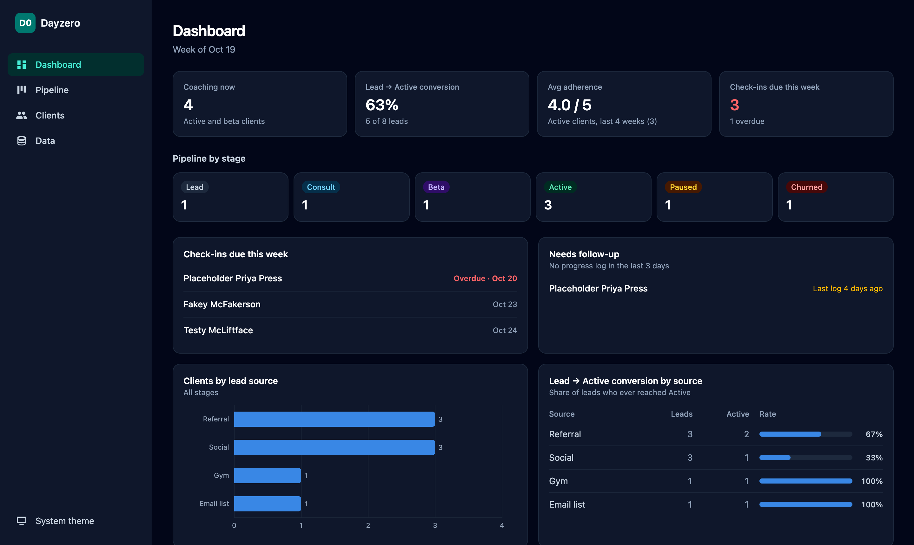
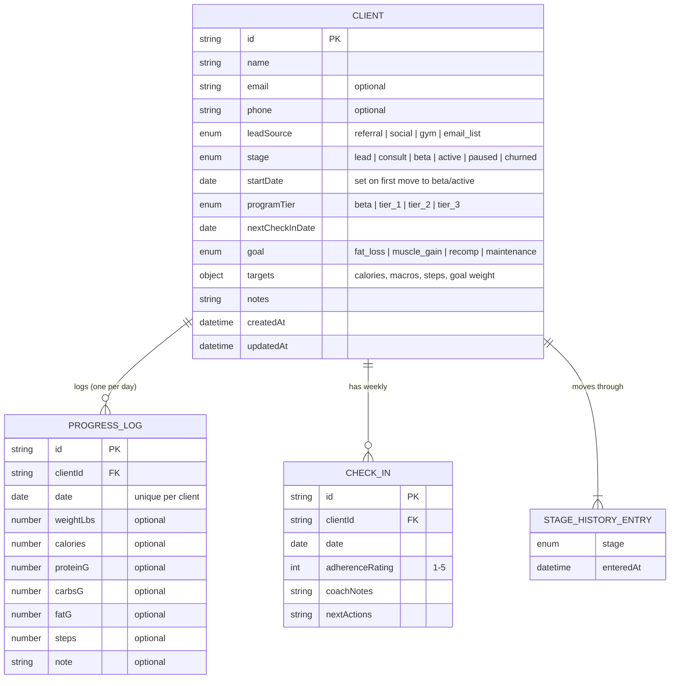
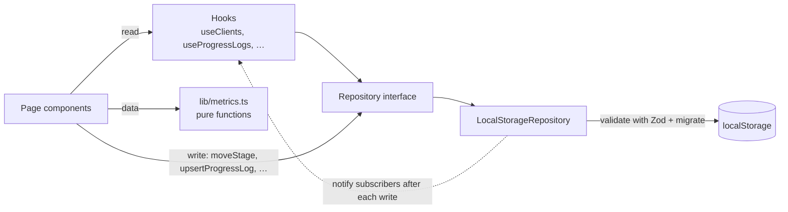

# Dayzero Client Tracker

An internal tool for **Dayzerotraining**, a small online fitness-coaching business. It manages
the client pipeline (lead → consult → beta → active) and tracks each client's progress
(weight, nutrition, steps and weekly check-ins) in one place, on desktop or a phone at the gym.

> **Live demo:** _add your deployed link here_ · All data in the demo is fictional.

## The problem

With six active clients and a growing list of leads, the business was running on a mix of
spreadsheets, notes apps and messages. That caused three recurring problems:

1. **Leads slipped through the cracks.** There was no single view of who was at which stage,
   or which lead sources actually turned into paying clients.
2. **Check-ins were easy to miss.** Nothing flagged an overdue weekly check-in or a client who
   had quietly stopped logging, which is the earliest warning sign of churn.
3. **Progress was hard to read.** Daily weigh-ins are noisy (water, salt, sleep), so raw numbers
   made good weeks look bad and vice versa. Clients and coach needed the trend, not the noise.

This app answers those three questions in under a minute each: *Who needs my attention this
week? Is this client on track? Which marketing channel is worth my time?*

## Screenshots

<!-- Add images to docs/screenshots/ and replace each line below with:  -->

- _Dashboard: screenshot coming soon_
- _Pipeline board: screenshot coming soon_
- _Client detail with charts: screenshot coming soon_
- _Mobile view: screenshot coming soon_

## Features

**Pipeline board**
- Kanban columns: Lead, Consult, Beta, Active and a shared Paused / Churned column (a badge shows
  which; click it to switch)
- Drag with mouse, touch (press and hold) or keyboard (Space to pick up, ←/→ to change column,
  Space to drop), with screen-reader announcements
- Every move is recorded in the client's stage history, which powers the conversion metrics
- Overdue check-ins are highlighted in red

**Client list**
- Search by name; filter by stage, lead source and tier; sort by name, start date or next check-in

**Client detail**
- Quick "Log today" form (weight, calories, macros, steps, note) that also back-fills past days
- Charts: weight with 7-day moving average and goal line, daily calories vs target (±10% band),
  stacked daily macros, daily steps vs target
- Date range: 2 weeks / 4 weeks / 12 weeks / all
- Summary stats: weight change, average calories / protein / steps, % of days on calorie target,
  % of days on step target
- Weekly check-ins with a 1–5 adherence rating, notes and next actions; saving one schedules
  the next check-in a week later
- Editable profile and targets; full log history table

**Metrics dashboard**
- Clients coaching now, overall Lead → Active conversion, average adherence, check-ins due
- Pipeline counts by stage, clients by lead source, conversion by lead source
- "Check-ins due this week" and "Needs follow-up" (no log in 3 days) lists, each linking to the client

**Data management**
- Export everything as a JSON backup; import a backup (validated and previewed before anything
  changes); reset to demo data; start fresh

**Quality**
- Responsive: sidebar on desktop, bottom navigation on mobile
- Light, dark and system themes
- Loading, empty and error states on every view
- If saved data is ever corrupted, the app keeps a backup copy and offers recovery instead of crashing

## Getting started

Requires Node.js 22.12 or newer.

```bash
npm install      # install dependencies
npm run dev      # start the dev server at http://localhost:5173
npm test         # run tests in watch mode (npm run test:run for a single run)
npm run lint     # lint
npm run build    # type-check and build for production into dist/
```

The first launch loads fictional demo data. Use **Data → Start fresh** to begin with real clients.

## Architecture

### Tech stack

React 18 · TypeScript (strict) · Vite · Tailwind CSS · React Router · dnd-kit · Recharts ·
Zod · date-fns · Vitest + React Testing Library

### Folder structure

```
src/
  components/     Shared UI: layout, nav, badges, dialogs, empty/loading/error states
  features/
    pipeline/     Kanban board, columns, cards, keyboard drag logic
    clients/      Client list, detail page, forms, charts
    dashboard/    Metrics dashboard
    settings/     Export / import / reset
  hooks/          Data-fetching hooks (useClients, useProgressLogs, …)
  lib/            Pure logic: metrics.ts, dates, formatting
  repositories/   Repository interfaces + localStorage implementation, migrations, errors
  schemas/        Zod schemas — the single source of truth for all types
  seed/           Deterministic demo data
  test/           Test helpers and fixtures
```

### Data model



All of this is stored as one versioned document: `{ schemaVersion, clients, progressLogs, checkIns }`.
The same shape is the export/import file format.

### Repository pattern, and why

UI code never touches `localStorage`. It talks to a `Repository` interface
([`src/repositories/types.ts`](src/repositories/types.ts)) made of four parts:
`ClientRepository`, `ProgressRepository`, `CheckInRepository` and `DataRepository`.
`LocalStorageRepository` is today's implementation, injected once in `main.tsx` through React context.

- **Swappable backend.** Every method returns a `Promise`, even though localStorage is
  synchronous, so a `SupabaseRepository` can be dropped in later without changing a single component.
- **Business rules live in one place.** Appending to stage history, setting a start date the first
  time a client starts a program, one progress log per client per day (merging fields so a morning
  weigh-in isn't lost when calories are added at night) and cascading deletes are all enforced by the
  repository, not scattered across screens.
- **Testable.** Storage, clock and ID generation are injected, so tests run against in-memory storage
  with a fixed date.

**Validation and migrations.** Everything read from storage or imported from a file goes through
Zod. Stored data carries a `schemaVersion`; `migrate()` upgrades older data step by step
(a v0 → v1 migration is included and tested). If stored data can't be parsed or validated, the raw
value is copied to a backup key, nothing is overwritten, and the app shows a recovery screen with
options to download the raw data, load demo data or start empty.

### How metrics are computed

All metrics are pure functions in [`src/lib/metrics.ts`](src/lib/metrics.ts). They take data and
"today" as arguments and never read the clock or storage, so each is unit-tested in isolation.

| Metric | Definition |
|---|---|
| 7-day moving average | Average of the weigh-ins logged in the trailing 7 calendar days. Missed days are skipped (not counted as zero); shown once at least 3 weigh-ins are in the window. Uses history before the selected range so short ranges start accurately. |
| Calorie target hit % | Days with calories logged that were within ±10% of target ÷ days with calories logged. Unlogged days are excluded rather than counted as misses. |
| Step target hit % | Days with steps at or above target ÷ days with steps logged. |
| Weight change | Last weigh-in minus first weigh-in in the selected range. |
| Lead → Active conversion | Clients whose stage history includes Active ÷ clients whose history includes Lead. Clients who later paused or churned still count as converted; clients added directly at a later stage are excluded because they never entered the funnel. Also broken down by lead source. |
| Check-ins due this week | Active and beta clients whose next check-in falls on or before Sunday of the current Monday–Sunday week, including overdue ones. |
| Needs follow-up | Active and beta clients with no progress log today or in the previous 2 days (or never). |
| Average adherence | For each active client, the mean 1–5 rating of check-ins in the last 28 days; then the mean across clients, so clients who check in more often don't dominate. |

### Data flow



1. A page reads through a hook such as `useClients()`, which calls the repository and returns
   `{ status, data, error }` for loading, empty and error states.
2. User actions call repository methods directly (for example `moveStage` on drop).
3. After every write, the repository notifies subscribers; every mounted hook re-reads, so all views
   stay in sync. This also works across browser tabs via the `storage` event.
4. Pages pass the data through pure functions in `metrics.ts` and render the results.

## Testing

94 tests across 10 files:

- **Metrics:** every function in `metrics.ts`, including edge cases (empty data, missed days, range
  boundaries, week boundaries, division by zero)
- **Repository:** save/load, stage history, one-log-per-day merging, cascading deletes, change
  notifications, migration, corrupted JSON, invalid data, backup-once behaviour, full storage, import/export
- **Seed data:** passes validation, deterministic, covers every stage and lead source, realistic log spans
- **Components:** keyboard drag on the kanban updates stage and history; paused ↔ churned toggle; form
  validation; import rejects invalid files and previews valid ones

## Tradeoffs and decisions

- **localStorage instead of a backend (for now).** One coach, one device, zero hosting cost, works
  offline at the gym, and no client health data leaves the browser. The cost: no sync across
  devices, and data is lost if browser storage is cleared. Export/import is the stop-gap, and the
  repository interface keeps the migration path open.
- **One document instead of tables.** Simple to validate, migrate and export as a whole. At this scale
  (hundreds of logs) reading the whole document is instant; at thousands of clients it wouldn't be,
  which is another reason the next step is a real database.
- **Async interface over sync storage.** Slightly more ceremony now in exchange for not touching the UI
  when moving to a network backend.
- **Stage history over a single stage field.** Storing every transition with a timestamp is what makes
  conversion (and later, time-in-stage) measurable.
- **Hit rates exclude unlogged days.** Counting a missing log as a miss would mix two different
  problems (not logging vs. not hitting target). Logging consistency is tracked separately by the
  follow-up list.
- **Custom data hooks instead of a data-fetching library.** The store is local and small; a tiny
  subscribe-and-refetch hook covers it. With a network backend, something like TanStack Query would
  earn its place (caching, retries, background refresh).

**What changes for multiple users:** a hosted database with row-level security, authentication and
per-coach data ownership; server-side validation (the same Zod schemas can be shared); conflict
handling for edits from two devices; audit history; and privacy/consent handling appropriate for
health-related data.

## Roadmap

1. **Supabase backend + auth.** Implement `SupabaseRepository` against the existing interface;
   Postgres tables mirroring the schemas; row-level security per coach; a one-time import from a JSON
   backup.
2. **Client-facing logging portal.** Clients log their own weight, food and steps from their phone;
   the coach view stays as it is.
3. **Wearable and step sync.** Import steps (and optionally weight) from Apple Health and Google Fit
   so clients don't type them in.
4. **Automated check-in reminders.** Email or SMS reminders before a check-in is due and a nudge when
   a client hasn't logged for 3 days, using the same rules as the dashboard.
