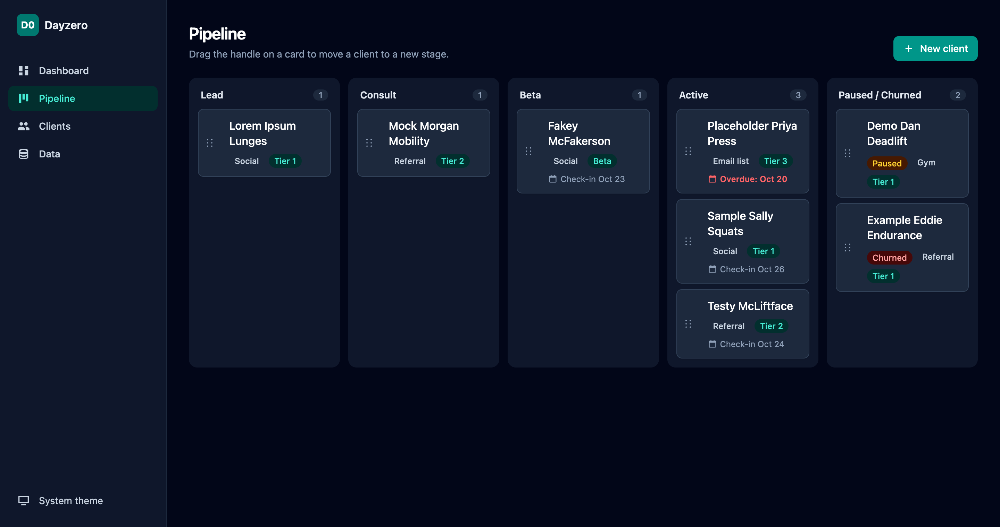
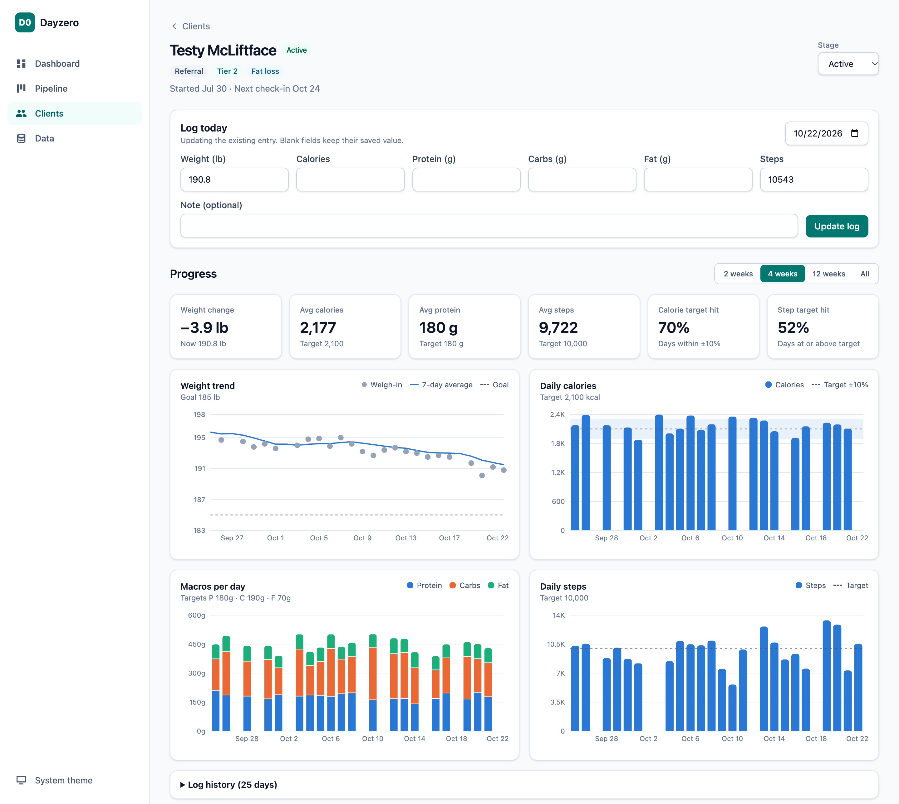
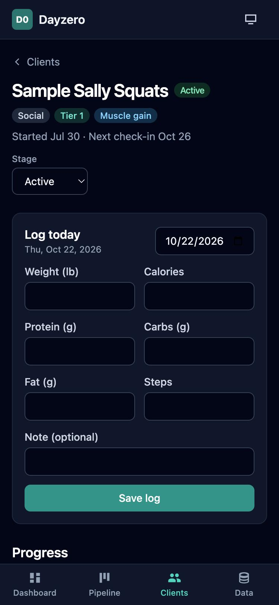
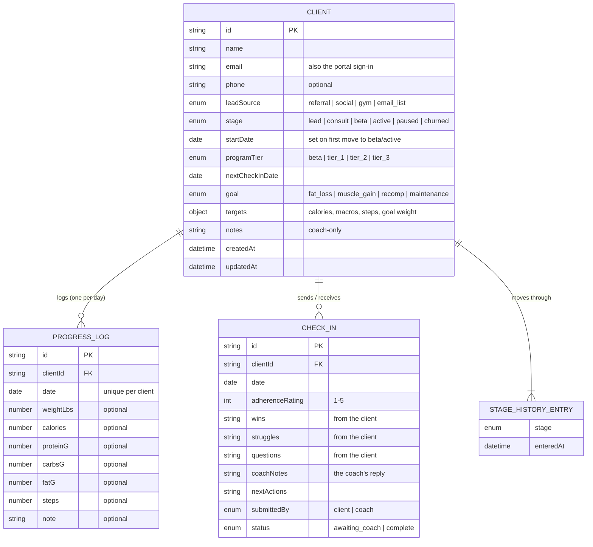
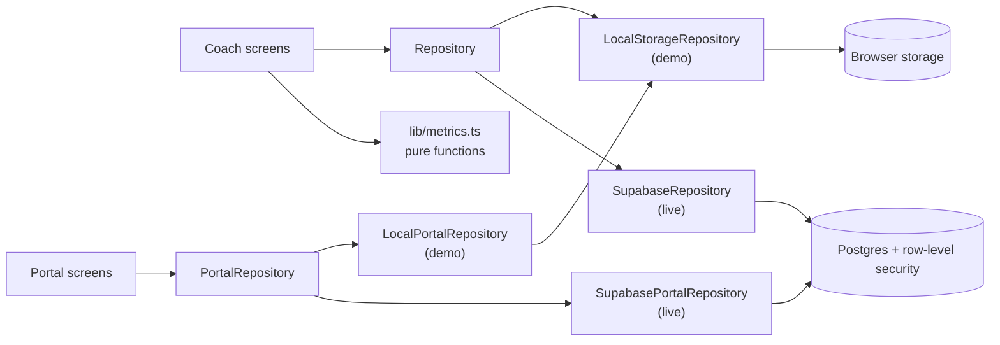

# Dayzero Client Tracker

An app for **Dayzerotraining**, a small online fitness-coaching business. The coach manages the
client pipeline (lead → consult → beta → active) and each client's progress; clients log their own
weight, food and steps and send weekly check-ins from their phone, and the coach replies in the app.

> **Live demo:** [dayzero-client-tracker.vercel.app](https://dayzero-client-tracker.vercel.app) · Try both the
> coach view and the client portal. All demo data is fictional and stays in your browser.

## The problem

With six active clients and a growing list of leads, the business was running on a mix of
spreadsheets, notes apps and messages. That caused four recurring problems:

1. **Leads slipped through the cracks.** There was no single view of who was at which stage,
   or which lead sources actually turned into paying clients.
2. **Check-ins were easy to miss.** Nothing flagged an overdue weekly check-in or a client who
   had quietly stopped logging, which is the earliest warning sign of churn.
3. **Progress was hard to read.** Daily weigh-ins are noisy (water, salt, sleep), so raw numbers
   made good weeks look bad and vice versa. Clients and coach needed the trend, not the noise.
4. **Copying client updates by hand.** Clients sent numbers and check-ins by text; the coach retyped them.

The app answers the coach's questions in under a minute each (*Who needs my attention this week?
Is this client on track? Which marketing channel is worth my time?*) and lets clients enter their
own data so nothing is retyped.

## Screenshots

**Dashboard:** who needs attention this week, and which lead sources convert


**Pipeline:** drag clients between stages with mouse, touch or keyboard



**Client detail:** quick daily logging, summary stats and trend charts (light theme)



**On a phone:** bottom navigation and a log form sized for use at the gym



## Features

**Three areas in one app**
- `/demo`: the full coach app on fictional data, with no sign-in, plus a preview of the client portal
- `/coach`: the real coach app, signed in, backed by an online database
- `/me`: the client portal, where each client sees only their own data

**Client portal**
- Sign in with an emailed link or 6-digit code; no password
- **Today:** log weight, calories, macros and steps (also back-fills past days); daily targets at a glance
- **Check-in:** rate the week 1–5 and share wins, struggles and questions; read the coach's replies
- **Progress:** their own weight trend, calories and steps vs target, and summary stats

**Pipeline board**
- Kanban columns: Lead, Consult, Beta, Active and a shared Paused / Churned column (a badge shows
  which; click it to switch)
- Drag with mouse, touch (press and hold) or keyboard (Space to pick up, ←/→ to change column,
  Space to drop), with screen-reader announcements
- Every move is recorded in the client's stage history, which powers the conversion metrics
- Overdue check-ins are highlighted in red

**Client list**
- Search by name; filter by stage, lead source and tier; sort by name, start date or next check-in

**Client detail**
- Quick "Log today" form; charts for weight (7-day moving average and goal line), calories vs target
  (±10% band), stacked daily macros and steps vs target; date range 2 / 4 / 12 weeks / all
- Summary stats: weight change, average calories / protein / steps, % of days on calorie and step target
- Check-ins sent by the client are flagged **Needs your reply**, with a reply form that also schedules
  the next check-in; the coach can also record a check-in done in person
- **Client portal card:** whether the client has signed in, plus a ready-to-send invite message
- Editable profile and targets (coach notes are private to the coach); full log history table

**Metrics dashboard**
- Clients coaching now, overall Lead → Active conversion, average adherence, check-ins due
- Pipeline counts by stage, clients by lead source, conversion by lead source
- "Check-ins awaiting your reply", "Check-ins due this week" and "Needs follow-up" (no log in 3 days)

**Data management**
- Export everything as a JSON backup. In the demo: import a backup (validated and previewed first),
  reset to demo data, or start fresh

**Quality**
- Responsive: sidebar on desktop, bottom navigation on mobile; light, dark and system themes
- Loading, empty and error states on every view; recovers automatically when a new version is deployed
  while a tab is open

## Getting started

Requires Node.js 22.12 or newer.

```bash
npm install      # install dependencies
npm run dev      # start the dev server at http://localhost:5173
npm test         # run tests in watch mode (npm run test:run for a single run)
npm run lint     # lint
npm run build    # type-check and build for production into dist/
```

The demo works with no further setup. To switch on sign-in, the coach area and the client portal:

1. Create a free [Supabase](https://supabase.com) project.
2. In its SQL editor, run [`supabase/schema.sql`](supabase/schema.sql), then add the coach's email:
   `insert into public.coaches (email) values ('you@example.com');`
3. Optionally run [`supabase/rls-selftest.sql`](supabase/rls-selftest.sql); every row should say PASS.
4. In Authentication → URL Configuration, set the Site URL to your app's address and add
   `https://<your-app>/auth/callback` as a redirect URL.
5. In Authentication → Emails → Magic Link, add `{{ .Token }}` to the message so the email also
   contains a 6-digit code.
6. Create `.env.local` (and the same variables in your host) with the project URL and the
   publishable (anon) key:

   ```
   VITE_SUPABASE_URL=https://<project>.supabase.co
   VITE_SUPABASE_ANON_KEY=<publishable key>
   ```

## Architecture

### Tech stack

React 18 · TypeScript (strict) · Vite · Tailwind CSS · React Router · dnd-kit · Recharts ·
Zod · date-fns · Supabase (Postgres, auth, row-level security) · Vitest + React Testing Library · PGlite

### Folder structure

```
src/
  areas/          The demo, coach and client-portal areas: which data source and screens each uses
  auth/           Sign-in pages, session state and role guards
  components/     Shared UI: layout, nav, badges, dialogs, empty/loading/error states
  features/
    pipeline/     Kanban board, columns, cards, keyboard drag logic
    clients/      Client list, detail page, forms, charts
    checkins/     Check-in card, rating picker, coach reply form (shared by coach and portal)
    portal/       Client portal: Today, Check-in, Progress
    dashboard/    Metrics dashboard
    settings/     Export / import / reset
    landing/      Home page
  hooks/          Data hooks that re-run when data changes (useClients, useMyCheckIns, …)
  lib/            Pure logic: metrics.ts, dates, formatting, config
  repositories/   Repository interfaces; localStorage (demo) and Supabase (live) implementations
  schemas/        Zod schemas: the single source of truth for all types
  seed/           Deterministic demo data
supabase/         Database schema, security rules and their self-test
```

### Data model



The same model is a versioned JSON document in the demo (`{ schemaVersion, clients, progressLogs, checkIns }`,
also the backup file format) and Postgres tables in the live app. Coach notes sit in a separate
`client_private` table so clients can never read them.

### Repository pattern, and why

UI code never talks to storage directly. It uses two interfaces in
[`src/repositories/types.ts`](src/repositories/types.ts):

- **`Repository`**, the coach's view of everything, implemented by `LocalStorageRepository` (demo)
  and `SupabaseRepository` (live).
- **`PortalRepository`**, one client's view of their own data, implemented by `LocalPortalRepository`
  (demo preview) and `SupabasePortalRepository` (live). It has no "client id" parameter: the client is
  always whoever is signed in, so there's no way to ask for someone else's data.

Each area plugs its implementation in through React context ([`src/areas`](src/areas)); the screens
are identical. The repository was introduced in v1 with an async interface precisely so this swap
needed **no changes to any screen**.

- **Business rules live in one place.** Stage history, start dates, one log per client per day
  (merging fields so a morning weigh-in isn't lost when calories are added at night) and cascading
  deletes are handled by the repositories, not scattered across screens.
- **Everything is validated.** Every row from the database and everything read from browser storage
  or a backup file goes through the same Zod schemas.
- **Migrations.** Stored data carries a `schemaVersion`; `migrate()` upgrades older data step by step
  (v0 → v1 → v2 are included and tested). Corrupted browser data is backed up, never overwritten,
  and the app offers recovery.

### Security model

Access is enforced by **row-level security in Postgres** ([`supabase/schema.sql`](supabase/schema.sql)),
not by the app. The app's route guards only decide which screen to show.

| | Coach | Client | Signed in, not added | Signed out |
|---|---|---|---|---|
| Client profiles | all | own (read-only) | none | none |
| Coach notes | all | none | none | none |
| Daily logs | all | own (read/write) | none | none |
| Check-ins | all, can reply | own (read); can send new ones with no reply and status "awaiting" | none | none |

- The coach is whoever's email is in the `coaches` table. Clients are linked to their profile by email
  the first time they sign in (or immediately, if the coach adds them after they've signed in).
- The browser only ever has the public "anon" key. The secret service-role key isn't used anywhere.
- [`supabase/rls-selftest.sql`](supabase/rls-selftest.sql) signs in as a coach, a client, a stranger and a
  signed-out visitor and checks 24 rules. It also runs in the test suite against an in-memory Postgres
  (PGlite), and every rule has been checked by deliberately breaking it and confirming the test fails.

### How metrics are computed

All metrics are pure functions in [`src/lib/metrics.ts`](src/lib/metrics.ts). They take data and
"today" as arguments and never read the clock or storage, so each is unit-tested in isolation.

| Metric | Definition |
|---|---|
| 7-day moving average | Average of the weigh-ins logged in the trailing 7 calendar days. Missed days are skipped (not counted as zero); shown once at least 3 weigh-ins are in the window. Uses history before the selected range so short ranges start accurately. |
| Calorie target hit % | Days with calories logged that were within ±10% of target ÷ days with calories logged. Unlogged days are excluded rather than counted as misses. |
| Step target hit % | Days with steps at or above target ÷ days with steps logged. |
| Weight change | Last weigh-in minus first weigh-in in the selected range. |
| Lead → Active conversion | Clients whose stage history includes Active ÷ clients whose history includes Lead. Clients who later paused or churned still count as converted; clients added directly at a later stage are excluded because they never entered the funnel. Also broken down by lead source. |
| Check-ins due this week | Active and beta clients whose next check-in falls on or before Sunday of the current Monday–Sunday week, including overdue ones. |
| Check-ins awaiting reply | Check-ins sent by clients that the coach hasn't answered, longest-waiting first. |
| Needs follow-up | Active and beta clients with no progress log today or in the previous 2 days (or never). |
| Average adherence | For each active client, the mean 1–5 rating of check-ins in the last 28 days; then the mean across clients, so clients who check in more often don't dominate. |

### Data flow



1. A page reads through a hook such as `useClients()` or `useMyCheckIns()`, which returns
   `{ status, data, error }` for loading, empty and error states.
2. User actions call repository methods directly (for example `submitCheckIn`).
3. After every write the repository notifies subscribers and every mounted hook re-reads. In the live
   app, hooks also re-read when the tab regains focus, so a client's new check-in shows up for the coach.
4. Pages pass the data through pure functions in `metrics.ts` and render the results.

The database code is a separate bundle that only loads on sign-in pages, so the public demo stays light.

## Testing

123 tests across 15 files:

- **Security rules:** the real `schema.sql` and `rls-selftest.sql` run against in-memory Postgres
  (24 access rules, email linking in both orders, safe to re-run, test data cleaned up)
- **Metrics:** every function in `metrics.ts`, including edge cases (empty data, missed days, range
  boundaries, week boundaries, division by zero)
- **Repositories:** save/load, stage history, one-log-per-day merging, cascading deletes, change
  notifications, migrations v0 → v2, corrupted data, import/export, check-in send → reply, portal
  isolation (a client can't reach another client's data)
- **Database mapping:** column conversion, null handling, timestamp normalisation, and invalid rows rejected
- **Sign-in guards:** signed out, wrong role, unknown email, correct role
- **Components:** keyboard drag on the kanban; form validation; import preview; and the full check-in
  round trip through real screens (client sends → coach replies → client reads the reply)

## Tradeoffs and decisions

- **Supabase for the live app.** Postgres, email sign-in and row-level security on a free tier, with no
  server code to run. Security lives in the database, so a bug in the app can't leak another client's data.
- **Email links instead of passwords.** Nothing for clients to forget. Sign-in emails also include a
  6-digit code, for when the link opens in a different browser (common with email apps on phones).
  Supabase's built-in email has a low hourly limit; sessions last weeks so this rarely matters, and a
  custom email provider can be added if it does.
- **Keep the demo on browser storage.** Anyone (including recruiters) can try both sides with no account,
  and the demo can never touch real data.
- **Clients start check-ins; the coach finishes them.** Clients report while the week is fresh; the
  coach answers in one place. The database rules stop clients from writing replies or marking a
  check-in complete.
- **Coach notes in a separate table.** Row-level security works per row, not per column, so private
  notes live where clients have no access at all.
- **Stage history over a single stage field.** Storing every transition with a timestamp is what makes
  conversion (and later, time-in-stage) measurable.
- **Hit rates exclude unlogged days.** Counting a missing log as a miss would mix two different
  problems (not logging vs. not hitting target). Logging consistency is tracked separately.
- **Custom data hooks instead of a data-fetching library.** A small subscribe-and-refetch hook covers
  both storage types. With more users, a library like TanStack Query would earn its place (caching,
  retries, live updates).
- **Privacy.** This is health data: clients see a short notice on sign-in, data is visible only to them
  and their coach, and a client's data can be deleted with their profile.

## Roadmap

1. **Wearable and step sync.** Import steps (and optionally weight) from Apple Health and Google Fit
   so clients don't type them in.
2. **Automated reminders.** Email a client before a check-in is due, and when they haven't logged for
   3 days, using the same rules as the dashboard.
3. **Live updates.** Push new check-ins to the coach instantly (Supabase Realtime) instead of on refresh.
4. **Multiple coaches.** Give each coach their own clients, with the same row-level security approach.
